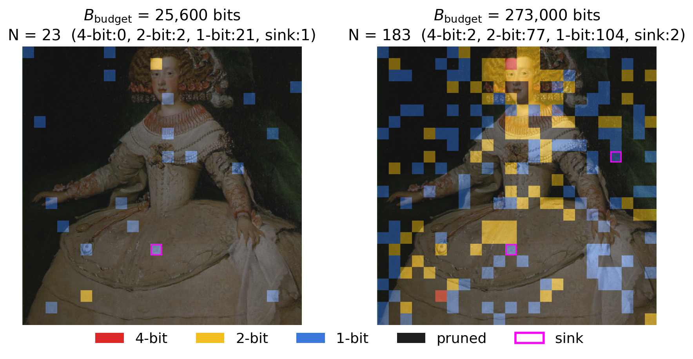

# Sink-Aware Mixed-Precision Split Inference for Large Multimodal Models

This is the official implementation of the following paper:

- "Bandwidth-Constrained Dynamic Split Inference for Large Multimodal Models via Sink-Aware Mixed-Precision Quantization"
  Chen Yen-Hsiu, Kento Uchida, Shinichi Shirakawa, Takayuki Nishio
  IEEE Consumer Communications & Networking Conference (CCNC) 2027

The code splits LLaVA-1.5-7B between an edge device and a cloud server:

- **Edge device:** the CLIP vision encoder, token selection and quantization.
- **Cloud server:** the projector and the LLM.

For the current uplink bandwidth, the edge decides how many visual tokens to send, and how many of them at 4, 2 and 1 bit, so that the end-to-end latency stays within a deadline. The method needs no training and runs on the stock `llava-v1.5-7b` checkpoint.



*Tokens selected at two budgets, colored by precision tier: red 4-bit, yellow 2-bit, blue 1-bit, black pruned. Attention-sink tokens (magenta outline) are always sent at the lowest precision.*

## Citation

```bibtex
@inproceedings{chen2027bandwidth,
  title     = {Bandwidth-Constrained Dynamic Split Inference for Large Multimodal Models via Sink-Aware Mixed-Precision Quantization},
  author    = {Chen, Yen-Hsiu and Uchida, Kento and Shirakawa, Shinichi and Nishio, Takayuki},
  booktitle = {Proceedings of the IEEE Consumer Communications \& Networking Conference (CCNC)},
  year      = {2027}
}
```

## Method overview

1. **Token selection.** [PruneSID](https://github.com/ZhengyaoFang/PruneSID) selects `N` diverse tokens out of the 576 CLIP patch tokens.
2. **Ranking.** The selected tokens are ranked by CLS attention, summed over all heads of the second-to-last ViT layer.
3. **Sink-aware demotion.** Every token whose score is more than 100× the median score (over all 576 tokens) is a sink candidate, and the two highest-scoring candidates, at most, are treated as *attention sinks*. Sinks stay in the sequence, but they are moved to the end of the ranking.
4. **Mixed-precision quantization.** The first `n4` tokens in the ranking are sent at 4-bit, the next `n2` at 2-bit and the rest at 1-bit. The quantizer is MSE-optimal (Lloyd–Max) and is applied after a fixed random rotation (TurboQuant). The payload is `4096·n4 + 2048·n2 + 1024·n1` bits, and each token adds 18 bits of metadata.
5. **Budget-optimal LUT.** For 8 anchor budgets, `(n4, n2, n1)` is searched offline on VQAv2 and stored in a lookup table.
6. **Round-down-and-refill.** At runtime the edge takes the largest LUT entry whose full transmitted size, metadata included, meets the deadline. It then fills the remaining bandwidth with extra 1-bit tokens.

The core implementation is `CLIPVisionTower.token_prunesid_quant_select` in [`llava/model/multimodal_encoder/clip_encoder.py`](llava/model/multimodal_encoder/clip_encoder.py).

## Requirements

- Linux and an NVIDIA GPU with at least 16 GB of memory. One LLaVA-1.5-7B FP16 run uses about 15 GB.
- Python 3.9
- PyTorch 2.0.1 with CUDA 11.8, plus the packages in [`requirements.txt`](requirements.txt)
- About 30 GB of disk space for the evaluation data
- Optional, for the latency measurements: an NVIDIA Jetson AGX Orin (edge) and an A100 (cloud)

We tested the code on A100 80GB GPUs and on a Jetson AGX Orin.

## How to clone

```bash
git clone https://github.com/yenhsiu/sink-aware-split-lmm.git
cd sink-aware-split-lmm
conda create -n splitlmm python=3.9 -y
conda activate splitlmm
pip install torch==2.0.1 torchvision==0.15.2 --index-url https://download.pytorch.org/whl/cu118
pip install -r requirements.txt
```

## Download models

You do not need to download anything by hand. On first use, these models are downloaded from the Hugging Face Hub:

- [`liuhaotian/llava-v1.5-7b`](https://huggingface.co/liuhaotian/llava-v1.5-7b), the full multimodal model
- [`openai/clip-vit-large-patch14-336`](https://huggingface.co/openai/clip-vit-large-patch14-336), the vision encoder

To use a local copy of LLaVA, pass `--model-path /path/to/llava-v1.5-7b` to `validate.py`, or set `LLAVA_MODEL_PATH` for every script.

## Download datasets

All benchmarks follow the LLaVA-1.5 evaluation layout under `playground/data/eval/`. First, download LLaVA's [`eval.zip`](https://drive.google.com/file/d/1atZSBBrAX54yYpxtVVW33zFvcnaHeFPy/view) into the repository root. It contains the question files. Then unzip it:

```bash
# Go to the root of the repository
mkdir -p playground/data
unzip eval.zip -d playground/data/
```

Then add the images and annotations of each benchmark, as described below. Run each block from the repository root. The final layout is listed in [docs/DATA.md](docs/DATA.md).

### COCO val2014 images (used by POPE and VQAv2)

```bash
cd playground/data/eval
wget http://images.cocodataset.org/zips/val2014.zip
unzip -q val2014.zip -d pope/ && rm val2014.zip     # -> pope/val2014/
mkdir -p vqav2 && ln -s ../pope/val2014 vqav2/val2014
```

### POPE

```bash
cd playground/data/eval/pope
mkdir -p coco
for split in adversarial popular random; do
  wget -P coco https://raw.githubusercontent.com/AoiDragon/POPE/e3e39262c85a6a83f26cf5094022a782cb0df58d/output/coco/coco_pope_${split}.json
done
```

### TextVQA

```bash
cd playground/data/eval/textvqa
wget https://dl.fbaipublicfiles.com/textvqa/data/TextVQA_0.5.1_val.json
wget https://dl.fbaipublicfiles.com/textvqa/images/train_val_images.zip
unzip -q train_val_images.zip && rm train_val_images.zip   # -> train_images/
```

### MMBench (dev)

```bash
cd playground/data/eval/mmbench
wget https://download.openmmlab.com/mmclassification/datasets/mmbench/mmbench_dev_20230712.tsv
```

### MME

The MME images are distributed by the MME authors on request. Follow the instructions in the [MME repository](https://github.com/BradyFU/Awesome-Multimodal-Large-Language-Models/tree/Evaluation), then place the data and the official scoring tool as follows:

```
playground/data/eval/MME/
├── llava_mme.jsonl                  # from eval.zip
├── convert_answer_to_mme.py         # from eval.zip
├── MME_Benchmark_release_version/   # MME images and question files
└── eval_tool/calculation.py         # official MME scoring script
```

### VQAv2 (val, used only for the LUT search)

```bash
cd playground/data/eval/vqav2
wget https://s3.amazonaws.com/cvmlp/vqa/mscoco/vqa/v2_Questions_Val_mscoco.zip
wget https://s3.amazonaws.com/cvmlp/vqa/mscoco/vqa/v2_Annotations_Val_mscoco.zip
unzip -q v2_Questions_Val_mscoco.zip && unzip -q v2_Annotations_Val_mscoco.zip && rm *.zip
cd ../../../..   # back to the repository root
python scripts/convert_vqav2_val_to_jsonl.py     # -> playground/data/eval/vqav2/llava_vqav2_mscoco_val2014.jsonl
```

## Lookup table (no training needed)

The method has no trainable parameters. Its only offline artifact is the budget-optimal LUT (Table I in the paper), which ships in [`configs/lut_vqav2.json`](configs/lut_vqav2.json):

| Budget (bits) | 25,600 | 41,000 | 66,000 | 106,000 | 170,000 | 273,000 | 439,000 | 589,824 |
|---|---|---|---|---|---|---|---|---|
| `(n4, n2, n1)` | (0,2,21) | (0,0,40) | (0,0,64) | (1,21,57) | (8,55,24) | (2,77,104) | (4,111,190) | (25,206,64) |

The full trial history of the search for each budget is in [`paper/search_logs/`](paper/search_logs/). See [Search the LUT](#search-the-lut) to run the search again.

## Evaluate

`validate.py` runs inference on one benchmark and scores it with the official scorer. `--dataset` takes `mme`, `pope`, `textvqa`, `mmbench` or `vqav2`. Add `--save` to write the score to `results/`, and use `--cuda N` to choose the GPU.

PruneSID's PCA clustering is randomized. `--pca-seed` fixes it (default 42). Each number in the paper is the mean over seeds 42, 43 and 44.

### Proposed method

```bash
# One LUT budget (bits) on each benchmark
python validate.py --dataset mme     --budget 106000 --save
python validate.py --dataset pope    --budget 106000 --save
python validate.py --dataset textvqa --budget 106000 --save
python validate.py --dataset mmbench --budget 106000 --save

# The same with the other two seeds
python validate.py --dataset mme --budget 106000 --pca-seed 43 --save
python validate.py --dataset mme --budget 106000 --pca-seed 44 --save

# Any tier configuration, e.g. 1x 4-bit + 21x 2-bit + 57x 1-bit
python validate.py --dataset mme --n4 1 --n2 21 --n1 57 --save
```

### Uniform-precision baselines (PSID-Q1/Q2/Q4)

At budget `B`, PSID-Qb sends `floor(B / (1024·b))` tokens, all at `b` bits.

```bash
# B = 106,000 bits
python validate.py --dataset mme --n4 0  --n2 0  --n1 103 --save   # PSID-Q1
python validate.py --dataset mme --n4 0  --n2 51 --n1 0   --save   # PSID-Q2
python validate.py --dataset mme --n4 25 --n2 0  --n1 0   --save   # PSID-Q4
```

### Ablations of the sink handling

```bash
python validate.py --dataset mme --budget 106000 --no-sink-filter --save            # no sink handling
python validate.py --dataset mme --budget 106000 --sink-mode capa_rank --save       # contribution-based ranking
python validate.py --dataset mme --budget 106000 --sink-ratio 200 --save            # threshold 200x the median
python validate.py --dataset mme --budget 106000 --sink-max-candidates 576 --save   # demote every candidate (no cap of two)
```

### Original LLaVA-1.5 (576 tokens, FP16)

```bash
python validate.py --dataset mme --baseline --save
```

## Reproduce the paper

`reproduce.py` expands each experiment into `validate.py` runs. It skips runs whose result already exists in `results/`, so you can stop and restart a sweep. Use `--dry-run` to print the commands first, `--cuda N` to choose the GPU, and `--datasets`, `--budgets` or `--seeds` to run a subset.

| Command | Experiment | In the paper | Runs |
|---|---|---|---|
| `python reproduce.py main` | PSID-Q1/Q2/Q4 vs. Proposed, 4 benchmarks × 8 budgets × 3 seeds | Table II, Fig. 4 (filled markers) | 360 |
| `python reproduce.py fp16` | Original LLaVA-1.5 (576 tokens, FP16) | Table II (last row), Table VI | 4 |
| `python reproduce.py sink` | Sink handling: none / demotion of at most two sinks (ours) / demotion of all candidates (no cap) / contribution rank, MME, 8 budgets × 3 seeds | Table III | 96 |
| `python reproduce.py sink-threshold` | Detector sensitivity: τ ∈ {25, 50, 200}, MME, 3 budgets × 3 seeds | Table V | 27 |
| `python reproduce.py snap-refill` | Round-down-and-refill at 7 midpoint budgets (+ uniform baselines and proportional scaling) | Fig. 4 (hollow markers) | 324 |
| `python reproduce.py search` | Offline VQAv2 LUT search | Table I | 8 budgets × 50 trials |
| `python reproduce.py sink-explore` | Extra sink variants (`capa`, `capa_full`, `value_rank`, `capa_rank_cap`); not in the paper | – | 96 |

```bash
python reproduce.py main --dry-run               # list the 360 commands
python reproduce.py main --datasets mme --cuda 0 # run the MME part on GPU 0
python compare_results.py                        # compare each result with the paper
```

`compare_results.py` prints every cell next to the value in the paper. `!!` marks a cell that differs by more than rounding, and `--` marks a cell that has not been run yet. The paper's numbers are in [`paper/paper_data.py`](paper/paper_data.py).

**Determinism.** For a fixed PCA seed, the pipeline is deterministic. We re-ran every experiment in the paper with this repository and checked all 287 reported accuracy cells with `compare_results.py`. Repeated full-benchmark runs gave exactly the same scores. A different GPU, driver or library version can change the floating-point results slightly.

**Run time.** On one A100, one run takes 7–26 minutes. The median is about 9 minutes for MME, 16 for TextVQA and MMBench, and 19 for POPE. The `main` sweep needs about 90 GPU-hours.

## Search the LUT

The search uses Optuna's TPE sampler with 50 trials per budget. It runs on a 5,000-question random subset of VQAv2-val (split seed 42). The three uniform-precision allocations are the first trials.

```bash
python quantization_search.py --dataset vqav2 --split search --split-ratio 0.023326 \
    --n-trials 50 --seed 42 --budgets 25600 41000 66000 106000 170000 273000 439000 589824
```

The result is written to `results/search_vqav2_<budgets>.json`. The smallest budget (25,600) has only 49 feasible allocations, so it is searched exhaustively.

## Measure latency

The latency model in the paper is built from lookup tables measured on the hardware, in [`latency/data/`](latency/data/). To measure them again:

```bash
# On the edge device (Jetson AGX Orin)
python latency/measure_edge.py --device "Jetson AGX Orin"          # ViT forward pass and quantization time
python latency/measure_edge_prunesid.py --device "AGX Orin"        # PruneSID selection time vs. N
python latency/measure_latency_ori.py --device "Jetson AGX Orin"   # full model on the edge (edge-only baseline)

# On the cloud GPU (A100)
python latency/measure_cloud.py --device A100                      # projector + LLM prefill time vs. N
python latency/measure_latency_ori.py --device A100                # full model on the cloud (cloud-only baseline)
```

Each script writes `latency/data/results_<name>_<device>.csv`. `paper/paper_data.py` reads `results_edge_Jetson_AGX_Orin.csv`, `results_edge_prunesid_AGX_Orin.csv` and `results_cloud.csv`. To use your own measurements, rename your files to these names.

## Analyses and figures

```bash
python analysis/sink_statistics.py --n-images 500   # Table IV: sink frequency, attention share, retention (GPU, ~1 GB)
python analysis/deadline_robustness.py              # Sec. IV-H: deadline under bandwidth over-estimation (CPU)
python analysis/prompt_cost.py                      # Sec. IV-H: size of the text prompt per benchmark (CPU)

cd paper
python plot_vqav2_figures.py         # Fig. 4: performance vs. latency per benchmark
python plot_paper_figures.py         # Fig. 3: latency vs. bandwidth; Fig. 5: latency breakdown
PRUNESID_ROOT=/path/to/PruneSID python visualize_prunesid_tiers.py   # Fig. 2: token tiers (needs a GPU)
```

The figure scripts read their numbers only from `paper/paper_data.py`, so Figs. 3–5 need no GPU and no data. The rendered PDFs are in [`paper/figures/`](paper/figures/). Fig. 2 runs the reference PruneSID code: clone [PruneSID](https://github.com/ZhengyaoFang/PruneSID) and point `PRUNESID_ROOT` to the clone.

## Repository layout

```
validate.py               evaluate one configuration on one benchmark
quantization_search.py    offline LUT search (Optuna TPE)
validate_snap_refill.py   evaluate round-down-and-refill at midpoint budgets
reproduce.py              run every accuracy experiment in the paper
compare_results.py        compare results/ with the numbers in the paper
configs/lut_vqav2.json    the searched LUT
llava/                    LLaVA-1.5 inference code; our method is in model/multimodal_encoder/clip_encoder.py
turboquant/               vendored Lloyd–Max quantizer (MIT, see turboquant/LICENSE)
latency/                  latency measurement scripts and measured tables
analysis/                 sink statistics, deadline robustness and prompt-size analyses
paper/                    paper_data.py (every number in the paper), figure scripts, search logs
scripts/                  dataset conversion and MMBench scoring
docs/DATA.md              expected layout of playground/data/eval/
```

## Acknowledgements

This code builds on [LLaVA](https://github.com/haotian-liu/LLaVA) and [LLaVA-PruMerge](https://github.com/42Shawn/LLaVA-PruMerge) (Apache-2.0). The token selection is ported from [PruneSID](https://github.com/ZhengyaoFang/PruneSID) (Apache-2.0). The quantizer is vendored from [turboquant-pytorch](https://github.com/tonbistudio/turboquant-pytorch) (MIT). See [NOTICE](NOTICE) for details.

## License

Apache License 2.0. See [LICENSE](LICENSE) and [NOTICE](NOTICE).
